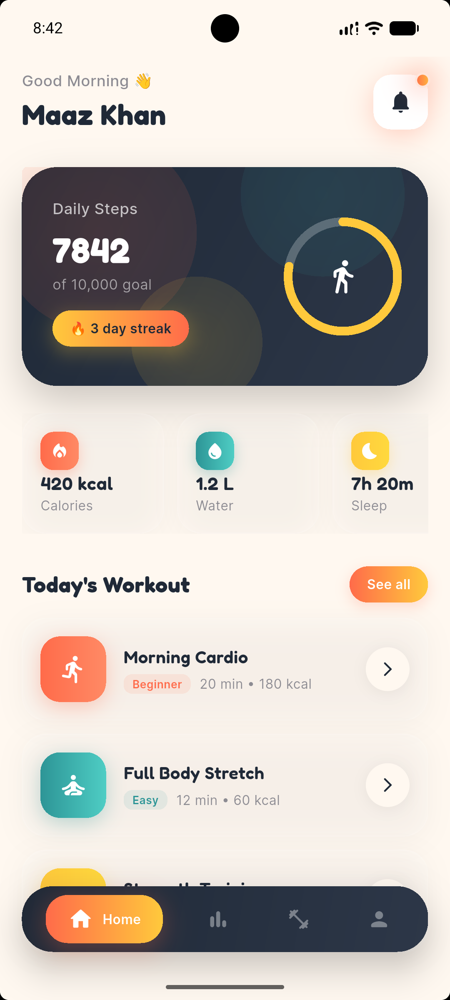
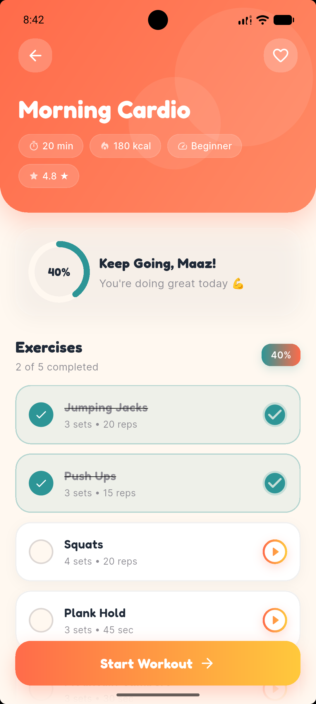
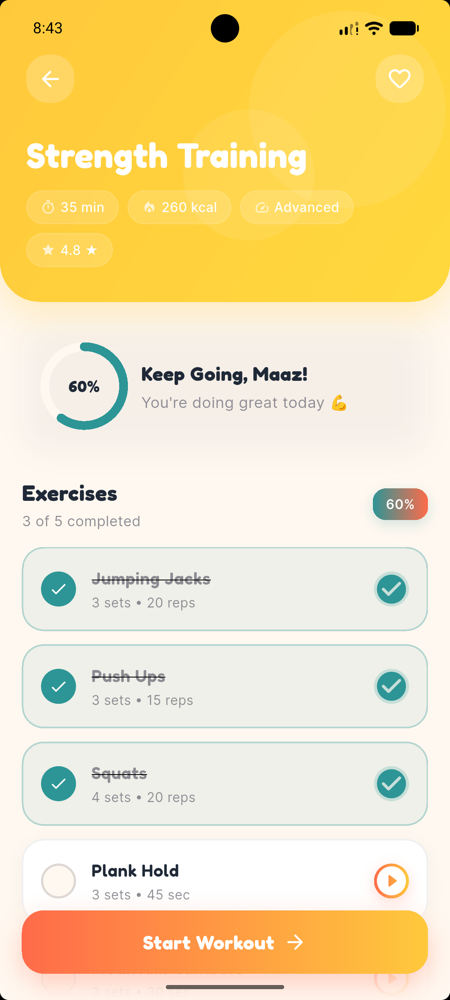

# 🏋️‍♂️ Flutter Fitness App

A modern, feature-rich cross-platform mobile application built with **Flutter** and **Dart** designed to help users track their fitness activities, monitor workouts, and maintain a healthy lifestyle with a clean and intuitive UI/UX.

---

## 📱 Screenshots

<p align="center">
  
  
  
</p>


---

## ✨ Features

- **🎨 Modern Material UI/UX Design:** Crafted with responsive components, smooth animations, and a sleek dark/light theme aesthetic.
- **📊 Interactive Progress Tracking:** Visualize stats and workout history through custom charts and indicators.
- **⏱️ Workout & Exercise Logs:** Track active sessions, sets, reps, and timers for various workout categories (Cardio, Strength, Yoga, etc.).
- **⚙️ Clean Architecture / State Management:** Structured for scalability, readability, and ease of maintenance.
- **🌐 Cross-Platform Support:** Fully responsive design optimized for both Android and iOS devices.

---

## 🛠️ Tech Stack & Libraries

- **Framework:** [Flutter](https://flutter.dev/) (Cross-platform UI toolkit)
- **Language:** [Dart](https://dart.dev/)
- **State Management:** *[e.g., Provider / Riverpod / Bloc]*
- **Local Storage / Backend:** *[e.g., SQLite / Hive / Firebase]*
- **Packages Used:**
  - `http` / `dio` (for network requests, if applicable)
  - `fl_chart` (for dynamic progress tracking charts)
  - `shared_preferences` (for lightweight local data caching)

---

## 📂 Project Structure

```text
lib/
│
├── constants/       # App colors, styles, and string constants
├── models/          # Data models (Workout, Exercise, User profile)
├── views/           # UI Screens (Home, Workout details, Profile, Analytics)
│   ├── components/  # Reusable custom widgets and UI fragments
│   └── screens/     # Full-page views
├── viewmodels/      # State management and business logic
├── services/        # Local database, API clients, or storage helpers
└── main.py / main.dart  # App entry point